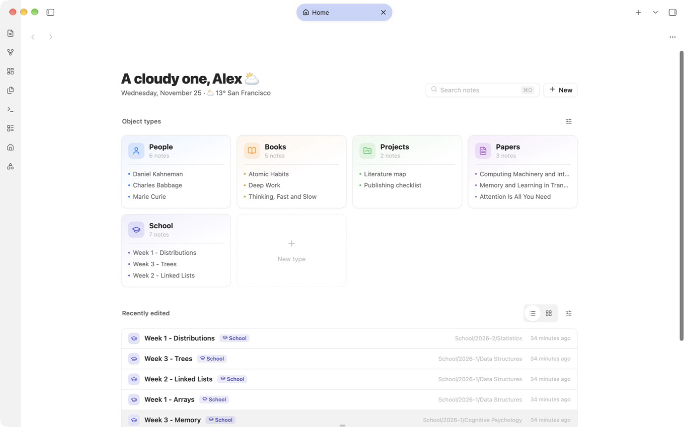
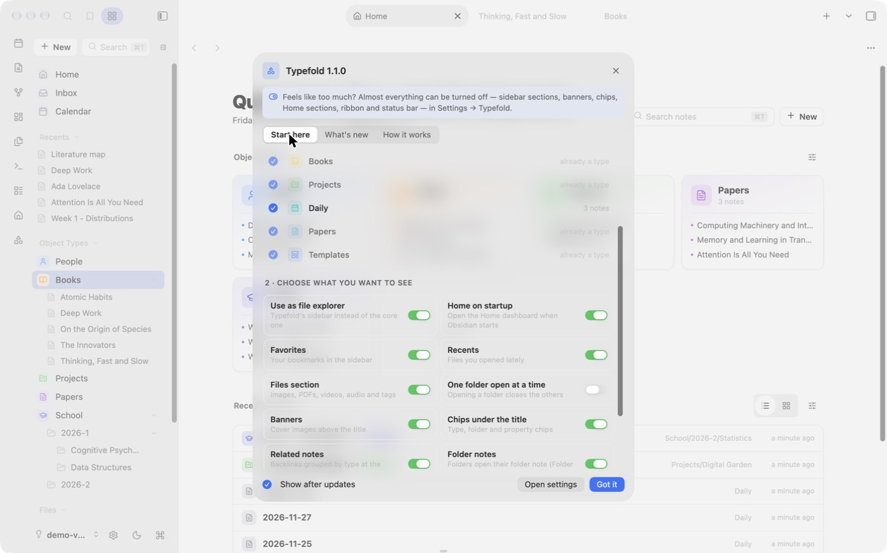
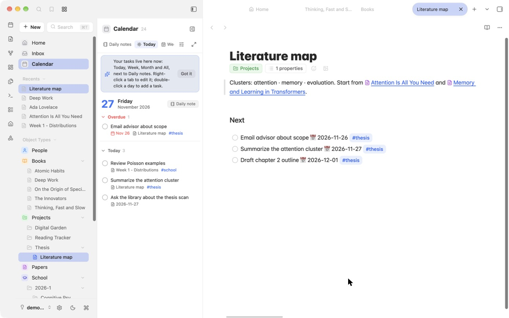
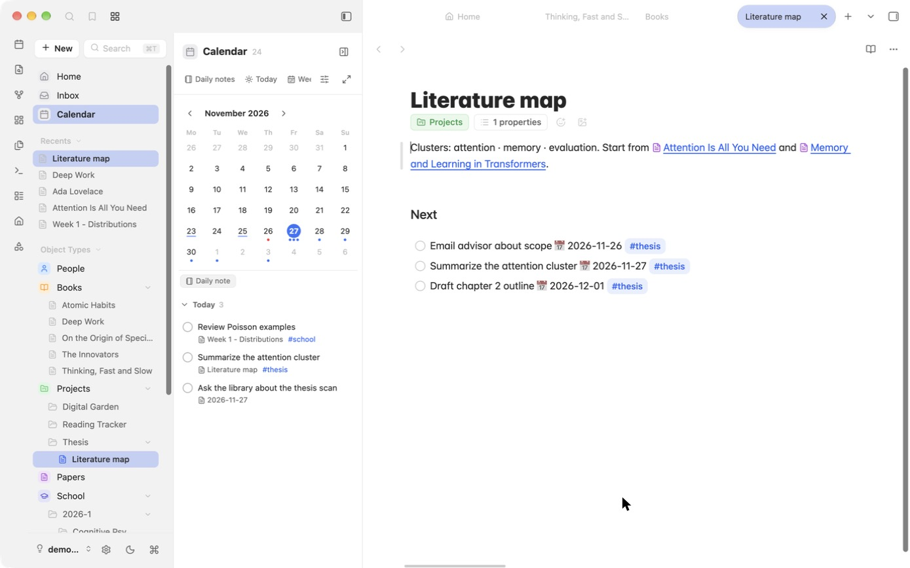
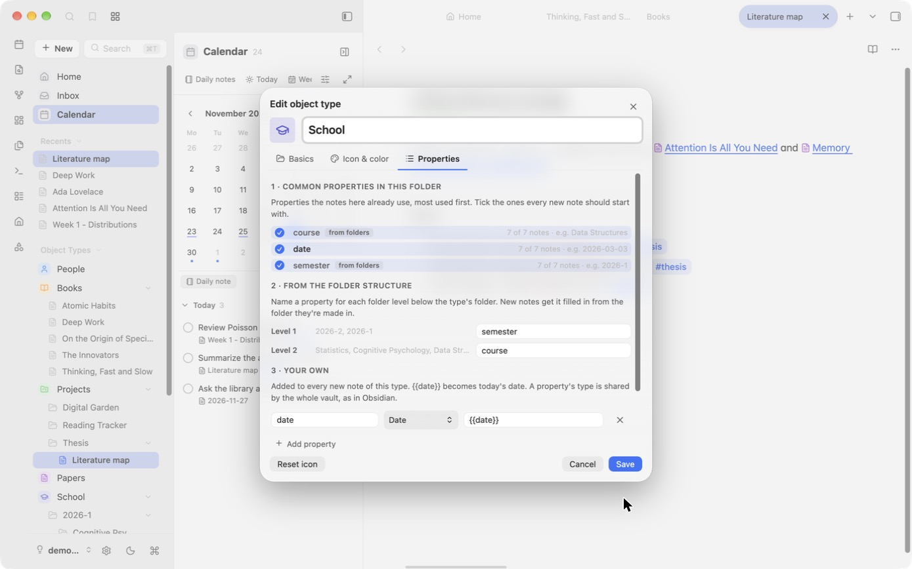
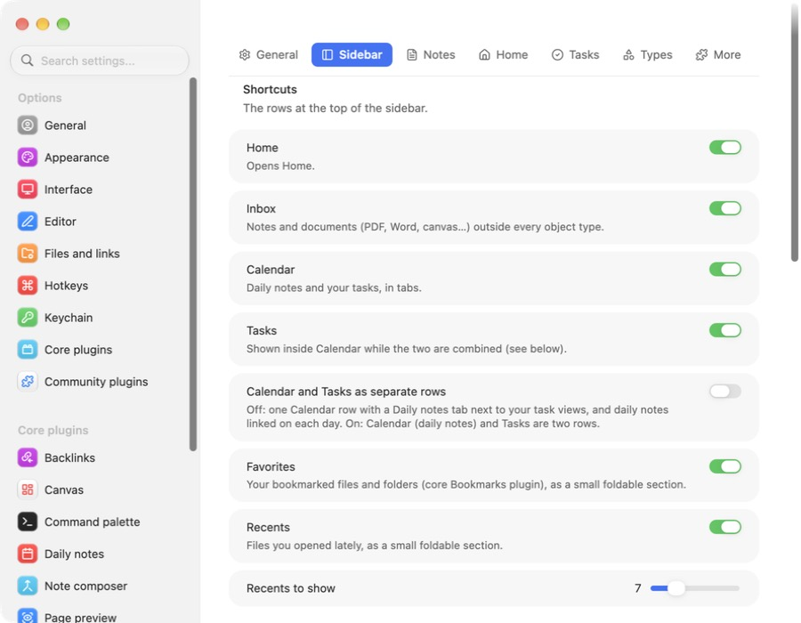

# Typefold

**Folders become object types in Obsidian.** Inspired by object-based note apps.

Register a folder as a type (People, Books, Projects, School…) and Typefold gives it a home in the sidebar, a page with a live board of everything in it, a banner and chips on every note, a Home dashboard, a calendar with your tasks, and a Notion-like search panel in every new tab. No frontmatter required: **a note's type is the folder it lives in**, and nested folders mean a note can belong to more than one type.



## Don't know where to start?

The first time you open Typefold, **Start here** lists your top-level folders. Tick the ones you want as object types, choose what Typefold should show, and press one button. You can open it again any time from *Settings → Typefold → General*.



Feels like too much? Almost every part of Typefold can be switched off — see [Make it yours](#make-it-yours).

## Features

### Sidebar navigator
- Your types, each with its own icon and colour, and the full folder tree under each — subfolders, sub-subfolders and the files in them (PDFs and documents included, with a small file-type tag).
- Shortcuts at the top — **Home**, **Inbox** (every note or document that isn't in a type) and **Calendar** — then small foldable **Favorites** (your core Bookmarks) and **Recents** sections, your **Object Types** and **Files**.
- An optional second panel lists the selected type or folder: sort by title / created / edited, group by date, folder or any property, and choose what each row shows — a two-line preview, tags, any properties.
- Expand / collapse everything in one click, drag to reorder types, archive what you don't need to see. Turn on **One folder open at a time** to keep a long tree short.
- Right-click anything for the file explorer's actions (open in new tab, rename, move, delete, open in default app…).
- Can replace the core File explorer (breadcrumbs and "Reveal file" open here too).


### Calendar and tasks
Calendar in the sidebar holds your daily notes and your tasks, in tabs:
- **Daily notes**, newest first.
- **Today** — today's tasks and anything overdue, with a link to today's daily note.
- **Week** — a section for each day.
- **Month** — a small calendar with a dot for every task due (red when it's late) and an underline on days that have a daily note. Pick a day to see its tasks.
- **All** — overdue, today, tomorrow, next 7 days, later and no date.

Double-click a day or a section to add a task right there, with that date. Right-click a task to delete it. Every view is yours to edit — name, icon, layout and filters (object type, tags, status, date) — and can place tasks by their **due** or **scheduled** date. ⤢ opens a full view with Month, Week, Day and List and a background of your choice.

Tasks come from one of three places (*Settings → Tasks*):
- **[TaskNotes](https://github.com/callumalpass/tasknotes)** — one note per task; add them in natural language ("Call mom tomorrow 3pm #family").
- **[Tasks](https://github.com/obsidian-tasks-group/obsidian-tasks)** — the checkbox tasks the Tasks plugin tracks, with its global filter, done dates and recurrence.
- **Checkboxes** — every `- [ ]` in your notes, with the note's title, tags and 📅 due date.

Prefer them apart? *Settings → Sidebar → Calendar and Tasks as separate rows*.

<p>
  
  
</p>

### Object types, made your way
One dialog for creating and editing a type, in three tabs:
- **Basics** — one or more folders, and which **pages** to make: *Don't create*, *This folder* (a type page with a table of all its notes) or *Folder + subfolders* (plus a board page in every subfolder). Also where new notes go, whether notes elsewhere can join through their frontmatter, and whether the type shows on Home.
- **Icon & color**.
- **Properties** — what every new note of this type starts with:
  1. **Common properties** the notes in that folder already use, most used first.
  2. **From the folder structure** — e.g. `School/2026-1/Statistics` → `semester: 2026-1`, `course: Statistics`.
  3. **Your own**, each with a type (text, list, number, checkbox, date, date & time), guessed from the notes that already use it.
  4. A **template** note whose text and properties are copied in (`{{title}}`, `{{date}}`, `{{time}}` are filled in).



### Type pages and folder boards
- A type's page: a banner in the type's colour, chips, and an embedded Bases board of all its notes.
- With [Folder notes](https://github.com/lostpaul/obsidian-folder-notes), clicking a folder opens its folder note with a board of that folder's notes. Typefold only creates folder notes when you ask it to.

### Notes
- Banner, icon and title, then type chips, a properties toggle, and buttons to set an icon or a banner.
- Banners can **Fill**, **Fit** or be dragged to a new position, or borrow the banner of a folder above the note or of its object type.
- Links get a small icon of the linked note's type.
- **Related** at the bottom: notes that link here and notes this one links to, grouped by type, as cards.


### Home dashboard and new-tab search
- **Home**: a greeting that changes with the time, the day and the weather, your types as cards (pick which ones), pinned notes and recently edited notes. Or make Home open **any note you choose**.
- **Home as a note**: put an empty ` ```typefold-home ``` ` code block in any note and the same dashboard appears there.
- **New tab (⌘T)**: a search panel — recent notes grouped by date, fuzzy search, filter by type, preview on the right. `↵` open · `⌘↵` new tab · `⌘L` copy link.


### Built-in view tabs for Bases
Every base — opened on its own or embedded in a note — shows its views as tabs right after the result count. Right-click a tab to give it an icon and colour.

### Works on mobile
Touch-sized rows and buttons, one pane at a time on phones, and the sidebar closes when you open a note.

## Make it yours

Settings are split into **General · Sidebar · Notes · Home · Tasks · Types · More**, and nearly everything has an on/off switch:

- **Sidebar** — each shortcut, Favorites, Recents, Files, counts, the New & Search buttons, the footer, one folder open at a time.
- **Notes** — banners, note icons, chips under the title, related notes, type icons before links, view tabs for Bases, folder notes, type pages.
- **Home** — the greeting, the type cards (and which types), pinned and recently edited notes, weather, opening Home on startup.
- **General** — ribbon buttons, the status bar, the new-tab search panel, the "what's new" window after updates.



## Companion plugins (optional)

Typefold works on its own. These add to it, and Typefold's settings show each one with an **Install / Enable** button:

| Plugin | What it adds |
|---|---|
| [Extended Base](https://github.com/jiwooroh/extended-base) ✦ | Notion-style Board / List / Feed views for type pages and boards (otherwise core Table and Cards are used) |
| [Folder notes](https://github.com/lostpaul/obsidian-folder-notes) | Folder pages and boards |
| [Iconize](https://github.com/FlorianWoelki/obsidian-iconize) | Use and sync Iconize's icon packs and emoji |
| [TaskNotes](https://github.com/callumalpass/tasknotes) or [Tasks](https://github.com/obsidian-tasks-group/obsidian-tasks) | A task source for Calendar (plain checkboxes work without either) |
| [Notion-style Comments](https://github.com/jiwooroh/notion-document-comments) ✦ | Margin comments in the same style |
| [Notion Selection Toolbar](https://github.com/jiwooroh/notion-selection-toolbar) ✦ | A floating formatting toolbar in the same style |

✦ by the same author. The core **Bases** plugin should be enabled for type pages, boards and view tabs.

## Getting started
1. Install and enable Typefold.
2. In **Start here**, tick the folders you want as object types — or use **+** next to *Object Types* in the sidebar, or right-click a folder → **Register as object type…**.
3. Open **Home** or **Calendar** from the sidebar, or press ⌘T to search.

A demo vault with sample People, Books, Projects, Papers, School and daily notes is in [`demo-vault/`](demo-vault). Open it with *Open folder as vault*, then install the companion plugins from the plugin's settings.

## Privacy and network use
- The Home greeting can show the weather. This is **off by default**; when you turn it on, the plugin requests the current weather for the latitude/longitude you enter from [open-meteo.com](https://open-meteo.com) (no account, no key, nothing else is sent).
- No other network requests, analytics or telemetry.

## Compatibility notes
Typefold reaches into a few Obsidian internals so it can feel built-in: it wraps the embed factory for `.base` files (view tabs in embedded bases), redirects the File explorer's *reveal* and the *New tab* command when you turn those options on, sets a property's type in Obsidian's property types only when you pick one yourself, and reads Folder notes', Iconize's, Extended Base's, TaskNotes' and Tasks' settings when they are installed. All of this is undone when the plugin is disabled.

## License
[MIT](LICENSE) © Jiwoo Roh
