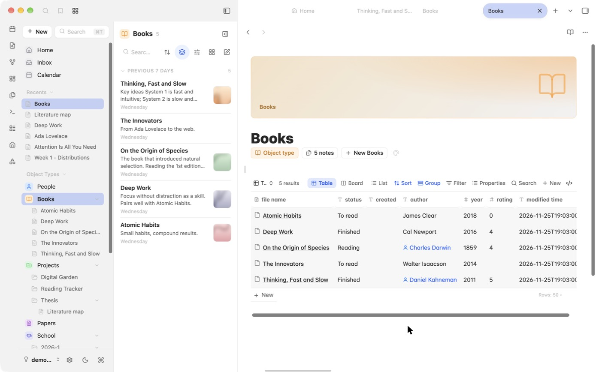
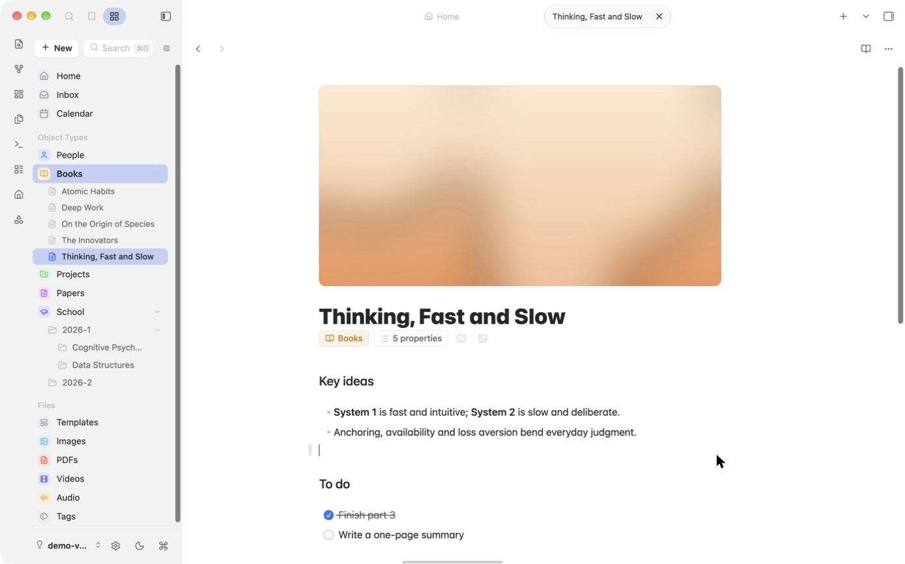
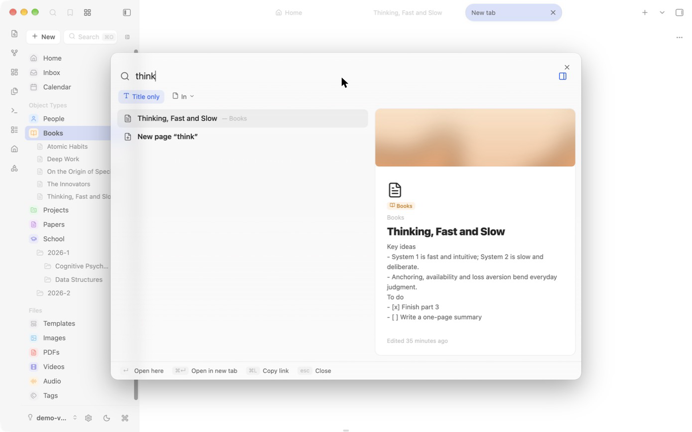

# Typefold

**Folders become object types in Obsidian.** Inspired by object-based note apps.

Register a folder as a type (People, Books, Projects, School…) and Typefold gives it a home in the sidebar, a page with a live board of everything in it, a banner and chips on every note, a Home dashboard, and a Notion-like search panel in every new tab. No frontmatter required: **a note's type is the folder it lives in**, and nested folders mean a note can belong to more than one type.


## Features

### Sidebar navigator
- Your types, each with its own icon and colour, and the full folder tree under each — subfolders, sub-subfolders and the files in them.
- An optional second panel lists the selected type or folder: sort by title / created / edited, group by date, folder (nested) or any property.
- Choose what each list row shows: a two-line preview of the note (on by default), its tags, and any properties you pick.
- Expand / collapse everything in one click, drag to reorder types, archive what you don't need to see.
- **Favorites**: everything you bookmark with the core Bookmarks plugin, in a Favorites row that opens like a folder.
- Can replace the core File explorer (breadcrumbs and "Reveal file" open here too).



### Type pages and folder boards
- Clicking a type opens its page: a banner in the type's colour, chips, and an embedded Bases board of all its notes.
- With [Folder notes](https://github.com/lostpaul/obsidian-folder-notes), clicking a folder opens its folder note, and new folders get a board automatically.
- Each type can fill properties from its folder levels (e.g. `School/2026-1/Statistics` → `semester: 2026-1`, `course: Statistics`) and give new notes default properties.

### Notes
- Banner, icon and title, then type chips, a properties toggle, and buttons to set an icon or a banner.
- Links get a small icon of the linked note's type.
- Notes that link here, grouped by type, as cards at the bottom.



### Home dashboard and new-tab search
- **Home**: a greeting that changes with the time, the day and the weather, every type as a card, and recently edited notes as a list or cards.
- **Home as a note**: put an empty ` ```typefold-home ``` ` code block in any note (for example `Home.md`) and the same dashboard appears there, so you can link to it, bookmark it, or set it as your start page with another plugin.
- **Calendar**: a month calendar at the top of the note list, with your daily notes listed newest first underneath. Days with a note get a dot; click a day to open its note or create it from your core Daily notes folder, format and template.
- **New tab (⌘T)**: a search panel — recent notes grouped by date, fuzzy search, filter by type, preview on the right. `↵` open · `⌘↵` new tab · `⌘L` copy link.



### Built-in view tabs for Bases
Every base — opened on its own or embedded in a note — shows its views as tabs right after the result count. Right-click a tab to give it an icon and colour.

### Works on mobile
Touch-sized rows and buttons, one pane at a time on phones, and the sidebar closes when you open a note.

## Companion plugins (optional)

Typefold works on its own. These add to it, and Typefold's settings show each one with an **Install / Enable** button:

| Plugin | What it adds |
|---|---|
| [Extended Base](https://github.com/jiwooroh/extended-base) ✦ | Notion-style Board / List / Feed views for type pages and boards (otherwise core Table and Cards are used) |
| [Folder notes](https://github.com/lostpaul/obsidian-folder-notes) | Folder pages and automatic boards for new folders |
| [Iconize](https://github.com/FlorianWoelki/obsidian-iconize) | Use and sync Iconize's icon packs and emoji |
| [Notion-style Comments](https://github.com/jiwooroh/notion-document-comments) ✦ | Margin comments in the same style |
| [Notion Selection Toolbar](https://github.com/jiwooroh/notion-selection-toolbar) ✦ | A floating formatting toolbar in the same style |

✦ by the same author. The core **Bases** plugin should be enabled for type pages, boards and view tabs.

## Getting started
1. Install and enable Typefold.
2. Right-click a folder in the file explorer → **Register as object type…** (or the **+** next to *Object Types* in the Typefold panel). Pick a name, icon and colour.
3. Open **Home** from the sidebar, or press ⌘T to search.

A demo vault with sample People, Books, Projects, Papers and School notes is in [`demo-vault/`](demo-vault). Open it with *Open folder as vault*, then install the companion plugins from the plugin's settings.

## Settings worth knowing
- **Use as default file explorer** — hide the core File explorer and route its commands here.
- **Open Home on startup**, **Search panel in new tabs**, **View tabs for Bases**.
- **Iconize icons** — *Use & sync* or *Ignore*.
- **Weather on Home** — needs a place and latitude/longitude.

## Privacy and network use
- The Home greeting can show the weather. This is **off by default**; when you turn it on, the plugin requests the current weather for the latitude/longitude you enter from [open-meteo.com](https://open-meteo.com) (no account, no key, nothing else is sent).
- No other network requests, analytics or telemetry.

## Compatibility notes
Typefold reaches into a few Obsidian internals so it can feel built-in: it wraps the embed factory for `.base` files (view tabs in embedded bases), redirects the File explorer's *reveal* and the *New tab* command when you turn those options on, and reads Folder notes', Iconize's and Extended Base's settings when they are installed. All of this is undone when the plugin is disabled.

## License
[MIT](LICENSE) © Jiwoo Roh
