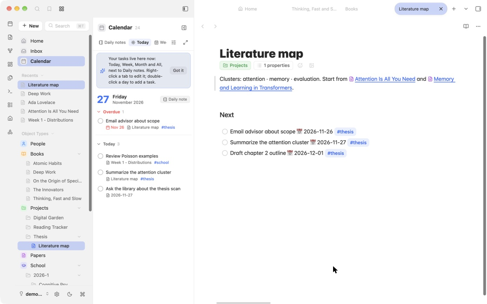

## Typefold 1.1.0

A big update: tasks in the calendar, a new way to create and edit object types, a Start here guide, and an off switch for almost everything.

### New
- **Tasks now live in Calendar.** Next to *Daily notes* there are task tabs — **Today**, **Week** (a section per day), **Month** (a small calendar with dots for due tasks) and **All**. Each day links to its daily note.
  - Double-click a day or section to add a task with that date; right-click a task to delete it.
  - Edit any view: name, icon, layout, filters (object type, tags, status, date), and whether tasks sit on their due or scheduled date.
  - ⤢ opens a full Month / Week / Day / List view with a background of your choice.
  - Task source: **TaskNotes**, the **Tasks** plugin, or plain `- [ ]` **checkboxes**.
  - Prefer them apart? *Settings → Sidebar → Calendar and Tasks as separate rows*.
- **Start here.** "Don't know where to start?" — turn several folders into object types at once and pick what Typefold shows.
- **One dialog for creating and editing a type**, in three tabs:
  - **Basics**: several folders, which pages to make (*Don't create* / *This folder* / *Folder + subfolders*), where new notes go, show on Home.
  - **Icon & color**.
  - **Properties**: common properties from the folder's notes (most used first), properties from the folder structure, your own (with a type, guessed from existing notes), and a template note.
- **Recents** and **Favorites** as small foldable sections; **Object Types** and **Files** fold too.
- **Inbox** now holds every document outside your types — PDFs, Office files and canvases too.
- **Home** can open Typefold's dashboard or any note you choose, and you pick which types get a card.
- **Banners**: borrow a banner from a folder above the note or from its type; Fill, Fit or drag to reposition. Image banners fill their box at the same height as type pages.
- **What's new** window after updates, with a full guide.

### Settings
- Settings are split into tabs: **General · Sidebar · Notes · Home · Tasks · Types · More**.
- New switches: ribbon buttons, status bar, chips under the title, note icons, sidebar footer, New & Search buttons, each shortcut, each Home section, Recents, type pages, folder notes, one folder open at a time.

### Fixes
- Folder notes no longer point at a `Folder.base` that doesn't exist — it's created for you (and repaired in existing vaults).
- Typefold no longer creates folder notes or type pages unless you ask it to.
- Deleting a type with "move its page to the trash" now removes both the page note and its base.
- Section header buttons in the sidebar are visible again with themes that pad icons.
- Note headers appear as soon as a note opens; long type lists and type pages open faster.
- A hint appears when an Iconize rule puts a big icon on a type page, with a one-click way to hide it.
