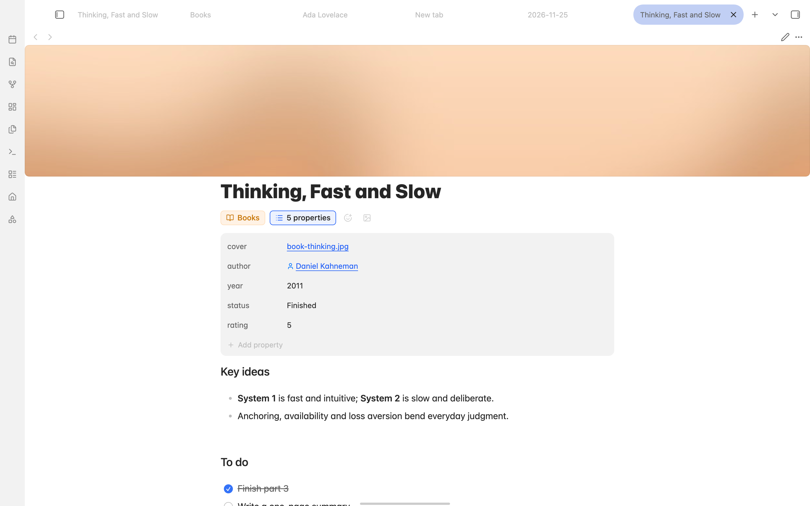

## Typefold 1.2.0

A new top for every note: properties you can edit under the title, a full-width cover, a breadcrumb, and more ways to colour and pick icons.

### New
- **Properties under the title.** The properties chip opens a box with the note's properties, written in Markdown.
  - Edit a value right there.
  - Right-click a property to rename it, change its type, choose when it shows (always, when filled, never), move or remove it. Drag to reorder.
  - Prefer Obsidian's own Properties? *Settings → Notes → Properties view*.
- **A Notion-like note top.** Banners can run across the whole note with the icon sitting on their edge, or stay as wide as the text (*Settings → Notes → Banner width*). Notes without a banner get a little more room above the icon.
- **Breadcrumb.** The folders a note sits in, in a slim header bar that shows when you point at it, or above the title (*Settings → Notes → Breadcrumb place*). Click a folder to show it in the sidebar; ⌘-click opens its folder note.
- **Palettes and your own colours.** Apple, Notion, Pastel, Matcha and Mono palettes, plus a colour picker. A note's colour now tints its big icon above the title too.
- **Icon packs and emoji.** Pick icons from Lucide, your Iconize icon packs or emoji, in tabs.
- **Tags under the title** (off by default): a note's tags as pills; click one to search it.

### Changes
- Right-click menus for notes show only Typefold's icon options, not Iconize's as well.
- Banners no longer show the folder names on them.

### Fixes
- An empty row from the Breadcrumbs plugin no longer adds space above the note.
- Notes redraw after the plugin is reloaded, so setting changes show right away.
